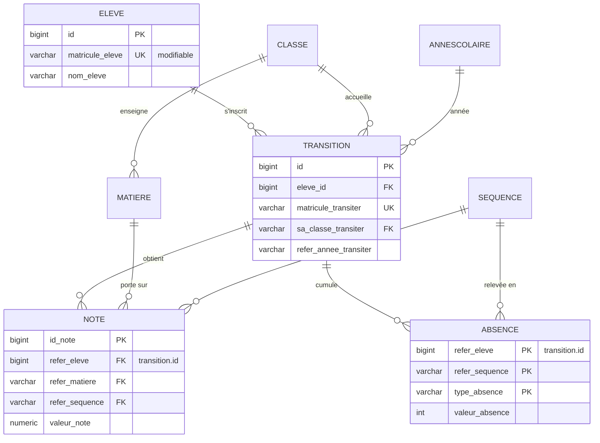

# RapidSchool Desktop : base de données PostgreSQL

Application Java Swing en réseau local : un poste serveur héberge PostgreSQL et
plusieurs postes (secrétariat, économat, censeurs) s'y connectent.

## Une base par année scolaire

Chaque année a sa propre base `bd_ecolgAAAA_AAAA` (58 tables), créée à la rentrée
à partir du même script de schéma.

- **Avantages** : archiver une année = un `pg_dump` ; une année close n'est pas modifiable
  depuis l'année en cours ; chaque base garde une taille stable.
- **Contreparties** : une évolution du schéma s'applique base par base (d'où la conversion
  automatique à l'ouverture d'une ancienne année, ci-dessous) ; une statistique sur plusieurs
  années interroge plusieurs bases.

## Noyau du modèle (format V7)

Script : [`sql/postgresql/01_schema_noyau.sql`](../sql/postgresql/01_schema_noyau.sql)

**Points de conception**
- `eleve` porte l'identité ; `transition` porte l'inscription de l'année (classe, redoublement, solvabilité).
  Notes, absences, frais, bourses et rabais référencent l'**inscription**.
- Clés étrangères **composées** `(refer_eleve, refer_annee) → transition(id, refer_annee_transiter)` :
  une note ne peut pas être rattachée à l'inscription d'une autre année.
- `ON DELETE RESTRICT` sur les liens élève → inscription → notes : un élève qui a des notes ne peut pas être supprimé par erreur.
- Index explicites sur les colonnes de jointure (PostgreSQL n'indexe pas les clés étrangères automatiquement).

## Migration V6 → V7 : du matricule à la clé technique

En V6, le matricule (texte saisi à l'inscription) servait de clé partout. Une faute
de frappe ne pouvait plus être corrigée sans casser les liens avec les notes.

La V7 introduit `eleve.id` / `transition.id` (bigint). La conversion des bases
existantes s'exécute **depuis l'application**, à l'ouverture d'une ancienne année :

1. sauvegarde `pg_dump` automatique ;
2. déconnexion des autres postes, verrou `ACCESS EXCLUSIVE` sur toutes les tables ;
3. contrôles préalables (inscription sans élève, doublons) : la moindre anomalie arrête tout ;
4. lignes orphelines mises de côté dans des tables `rs_conv_orphelins_*` (rien n'est perdu) ;
5. conversion de 8 tables rattachées, changement de type `varchar → bigint`, contraintes recréées ;
6. **contrôle final** : nombre de lignes et empreinte MD5 du contenu identiques avant/après,
   sinon `ROLLBACK` et la base reste intacte.

Version autonome et rejouable : [`sql/postgresql/02_migration_matricule_vers_id.sql`](../sql/postgresql/02_migration_matricule_vers_id.sql),
avec son jeu d'essai [`tests/jeu_demo_ancien_format.sql`](../tests/jeu_demo_ancien_format.sql).

**Validation réalisée** sur des bases réelles de plusieurs années : chaque
méthode d'accès aux données a été appelée sur l'ancienne base (ancien code) et sur la
base convertie (nouveau code), et les résultats ont été comparés (bulletins, relevés,
paiements, statistiques). Seuls des écarts d'arrondi flottant de l'ordre de 1e-15 subsistent.

## Compatibilité

- PostgreSQL **9.0 à 18** : le SQL de l'application évite volontairement les syntaxes récentes
  (`ON CONFLICT`, `GENERATED`, etc.) car certains établissements ont des serveurs anciens.
- Windows 8 à 11, 32 et 64 bits ; installateurs NSIS avec Java 8 (Eclipse Temurin) et PostgreSQL embarqués.
- Authentification `scram-sha-256` (PostgreSQL 10+ : `md5`).

## Exploitation

- Sauvegarde vérifiée et rotation : [`scripts/Sauvegarde-BaseAnnee.ps1`](../scripts/Sauvegarde-BaseAnnee.ps1)
- Rôles au moindre privilège : [`sql/postgresql/04_roles_moindre_privilege.sql`](../sql/postgresql/04_roles_moindre_privilege.sql)
- Requêtes de bulletin (moyenne pondérée, `RANK()`, contrôle d'index) : [`sql/postgresql/03_requetes_bulletin.sql`](../sql/postgresql/03_requetes_bulletin.sql)
