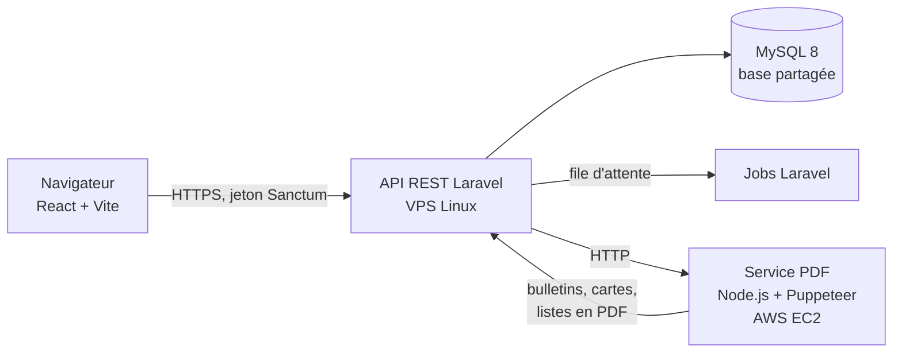
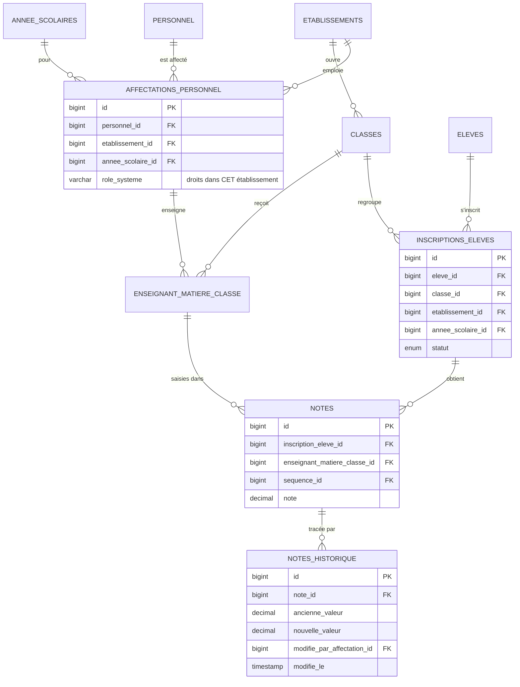

# RapidSchool web : plateforme SaaS multi-établissement

En ligne : <https://www.rapidschool.cm>

## Architecture

- **Front** : React/Vite, construit et servi en fichiers statiques.
- **API** : Laravel, environ 280 routes, authentification par jeton (Sanctum), double authentification optionnelle.
- **PDF** : rendu HTML → PDF délégué à un service Node.js/Puppeteer sur EC2, pour ne pas
  charger le serveur applicatif lors de l'impression des bulletins de toute une classe.

## Multi-tenant : base partagée, isolation par établissement

Tous les établissements partagent la même base ; chaque donnée métier porte
`etablissement_id` et `annee_scolaire_id`.

**Points de conception**
- **Les droits passent par l'affectation, pas par la personne.** Un enseignant peut travailler dans
  deux établissements avec des rôles différents ; son rôle est porté par `affectations_personnel`
  (personne × établissement × année).
- **Contrôle d'accès à chaque requête** : un middleware vérifie que l'utilisateur a une affectation
  active dans l'établissement demandé dans l'URL ; sinon `403`. Seul le rôle super-administrateur y échappe.
- **Unicité dans le bon périmètre** : `UNIQUE (code, etablissement_id, annee_scolaire_id)` sur les classes,
  deux écoles peuvent avoir chacune leur « 6e A ».
- **Traçabilité des notes** : toute modification de valeur, y compris par un administrateur, est
  enregistrée avec l'ancienne valeur, la nouvelle, l'auteur et l'heure.
- **Intégrité** : clés étrangères `ON DELETE RESTRICT` sur toute la chaîne élève → inscription → note.
- **Migrations versionnées** (Laravel), y compris le DDL SQL d'origine reproduit à l'identique
  pour les tables reprises d'une base existante.
